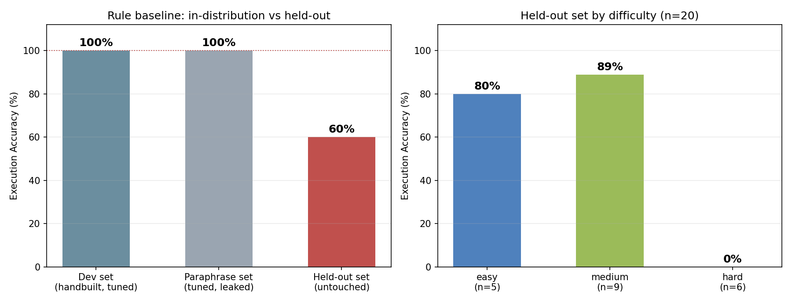

# PRJ-5 · NL2SQL 助手：让业务方用中文直接查游戏数据

> 一句话：把「最近7天各渠道活跃玩家数」翻译成能跑、能验证、且不会把库删掉的 SQL。

**为什么做这个**

数据分析师每天有 30%~50% 的时间在回答「帮我拉个数」。这类需求 90% 是同一个模板：
**一个指标 + 一个维度 + 一个时间窗 + 可能一个 TopN**。

真正的难点不是写 SQL，是三件事：

1. **口径**：「活跃」是登录算还是有时长算？「收入」含不含退款？—— 这件事只能靠指标字典约束，模型自己猜必错。
2. **可信**：生成完必须能验证。所以本项目的第一性产出不是 SQL，是**可复现的评测**。
3. **安全**：自然语言是不可信输入，「把订单表清空」也是一个合法的自然语言句子。

---

## 一、架构

```
用户提问
   │
   ├─ ① Schema Linking   问题里的词 → 表 / 列 / 枚举值
   │                      （最长关键词优先，解决 "商品" vs "商品类型" 的冲突）
   ├─ ② Query Planning   识别 指标 / 维度 / 时间窗 / TopN
   ├─ ③ SQL Rendering    按口径模板拼 SQL
   │
   ├─ ④ sql_guard        只读校验 · 单语句 · 禁危险函数 · 强制 LIMIT
   ├─ ⑤ 执行自检          跑通 + 结果非空 + 与口径字典一致
   └─ ⑥ 失败回退          护栏不过 → 退回规则引擎 / 反问澄清
```

`llm_adapter.py` 把 ①②③ 换成大模型（OpenAI 兼容协议，DeepSeek/通义/Kimi 直接换 base_url），
④⑤⑥ 保持不变 —— **这才是能上生产的形状**：模型负责泛化，工程负责兜底。

---

## 二、快速开始

```bash
cd projects/05-nl2sql
python3 data/generate_game_db.py        # 生成 game.db（6000 用户 / 15 万行为行 / 6133 笔订单）

cd python
python3 nl2sql.py "最近7天各渠道活跃用户数"
python3 run_eval.py                              # 开发集
python3 run_eval.py ../data/eval_holdout.json    # 真保留集
python3 make_chart.py                            # 出图 assets/eval_summary.png
```

接大模型（可选，不设 key 会自动降级）：

```bash
export LLM_API_KEY=sk-xxx
export LLM_BASE_URL=https://api.deepseek.com/v1
python3 llm_adapter.py "最近一周各渠道活跃玩家数"
```

---

## 三、评测结果（真实跑出来的，不是估的）

三套评测集，对应三种"自欺程度"：

| 评测集 | n | EX（执行准确率） | 说明 |
|---|---|---|---|
| Dev set（自建） | 40 | **100%** | ⚠️ 题目和规则同源，**这个数字没有意义** |
| Paraphrase（调优前） | 15 | **46.7%** | 换成口语问法，掉一半 |
| Paraphrase（调优后） | 15 | **100%** | 补了同义词，但该集已被污染，不能当成绩 |
| **Held-out（真保留，只跑一次）** | **20** | **60.0%** | 唯一可信的数字 |

保留集按难度：

| 难度 | n | EX | 典型失败 |
|---|---|---|---|
| easy（单指标/时间窗） | 5 | 80% | "昨天"（相对时间没覆盖） |
| medium（+维度分组） | 9 | 88.9% | 基本能打 |
| **hard（比率/多指标/嵌套/隐式列）** | **6** | **0%** | 占比、双指标、`IN 子查询`、"那一天" |



---

## 四、最有价值的四个发现

**1. "我自己出题自己测 100%" 是最危险的信号。**
开发集 100% → 口语问法立刻掉到 46.7%。因为题目是按规则的能力边界写的。
**任何 NL2SQL 项目的准确率，先问三件事：题是谁出的？调参时看过没有？n 多大？**
（本集 n=20，95% 置信区间约 ±21pp，别把 60% 当精确值。）

**2. 口语集的失败，8/8 全是"词表没覆盖"，不是"SQL 写错"。**
`玩家`→用户、`多少钱`→收入、`一周`→7天。这是词表问题，不是逻辑问题。
补了约 20 行同义词归一化后全部通过 —— **最便宜的一次提升，通常不在模型上。**

**3. 规则引擎的天花板不在 SQL，在"语言→口径"的映射。**
保留集里 hard 全灭，失败模式高度集中：比率（占比/人均）、多指标同查、隐式列引用（"收入最高的那一天"→ 要求模型自己想到 group by 日期）。
这些靠加规则会无限膨胀，靠大模型一句话就能泛化 —— 这就是 LLM 该切入的精确位置。

**4. 安全护栏不是可选项。**
`sql_guard.py` 实测能拦住 `DROP TABLE`、多语句注入、`--` 注释绕过、`load_extension`。
真实系统还要加：只读数据库账号（最硬的一层，代码拦不住就靠权限兜）。

---

## 五、已知局限（写清楚比藏着强）

- **数据是合成的**，只保证口径自洽，不代表任何真实产品的分布。
- **60% 的样本只有 20 条**，统计上很粗；扩到 200+ 才有工程参考价值。
- **不处理多轮**：「那上个月呢」这类指代需要会话状态，本项目未做。
- **不处理澄清**：问题本身口径不清（"活跃用户"没定义）时，正确做法是反问，现在是硬套字典。
- **LLM 分支未做量化对比**：代码和护栏都就绪，但没有 key 就没跑，报告里也不编数字。

---

## 六、参考资料

- Yu et al., *Spider: A Large-Scale Human-Labeled Dataset for Complex and Cross-Domain Semantic Parsing and Text-to-SQL*, EMNLP 2018, arXiv:1809.08887 —— EX（执行准确率）作为主指标的来源
- Li et al., *Can LLM Already Serve as A Database Interface? BIRD*, NeurIPS 2023, arXiv:2305.03111 —— 引入外部知识/证据对准确率的影响
- 注：本项目 60%/46.7%/100% 均为本仓库 `run_eval.py` 实测结果，可用 `python3 run_eval.py` 复现；行业基准数字不在此引用，避免与自建小样本混淆。
